# DevOps Revision & Supplementary Class

**Trainer runbook · 3 hours · Intermediate DevOps / Cloud Engineering**

> **Class outcome:** Students will connect identity, authorization, code quality, infrastructure-as-code, and container delivery into practical workflows. The class uses Azure/AKS, SonarQube Server, Kubernetes RBAC, Terraform, GitHub Actions, Docker Hub, and an Ubuntu VM.

## 0. Pre-class setup checklist

The live class is paced tightly. Prepare the cloud resources and access paths in advance; students should spend class time learning the controls and observing outcomes, not waiting for downloads or cloud provisioning.

### Accounts, repositories, and access

- [ ] A working GitHub account and a training repository for each pair or student. Protect `main`; use pull requests for changes.
- [ ] An Azure subscription with permission to update the training AKS cluster, create/manage a user-assigned managed identity and role assignments, and deploy resources in a dedicated lab resource group.
- [ ] A pre-existing AKS cluster with `kubectl` access. For Module 1, enable the AKS OIDC issuer and Microsoft Entra Workload ID before class.
- [ ] A Microsoft Entra user-assigned managed identity for the workload-identity exercise, plus a federated identity credential that trusts the intended Kubernetes service account subject.
- [ ] A demo Azure Key Vault containing a **non-sensitive training secret** and a Storage Account with a blob container. The lab identity should receive only the relevant data-plane roles.
- [ ] A self-hosted SonarQube Server instance on a stable HTTPS URL. Create a project, generate a project analysis token, and configure a quality gate before class.
- [ ] Confirm the GitHub Actions runner can reach SonarQube over HTTPS. A server bound to `localhost` on the trainer's laptop is **not** reachable from a GitHub-hosted runner. Use a reachable HTTPS endpoint or a self-hosted runner on the same private network.
- [ ] An Azure Storage Account/container for Terraform remote state, separate from the demo Storage Account created by Terraform. Enable blob versioning and appropriate recovery controls; scope CI access to the state container and deployment resource group.
- [ ] A dedicated Ubuntu VM for Module 6. Install Docker Engine, create a least-privilege deployment account, install the deployment script shown later, and confirm a safe SSH path from the runner. Prefer a self-hosted runner/bastion/VPN or narrowly allowlisted source IPs; do not broadly expose SSH to the internet.
- [ ] A Docker Hub repository. Prefer a public repository for the simplest classroom demo; if private, configure read-only registry authentication on the target VM.
- [ ] A rollback plan: preserve the last working image tag and know how to restart it if the deployment fails.

### Required tools on the trainer workstation

- [ ] Azure CLI (`az`), `kubectl`, and `kubelogin`.
- [ ] Terraform CLI, TFLint, Checkov, Git, Docker, Node.js/npm, and a text editor.
- [ ] A browser session signed in to the relevant Azure tenant and GitHub account.
- [ ] A terminal with `KUBECONFIG` pointing at the intended training cluster. Never use a production cluster for the RBAC exercise.
- [ ] Confirm clock/time synchronization; identity tokens and TLS flows can fail when clocks drift significantly.

### GitHub repository variables and secrets

Create only what applies to each exercise. Do not paste values into source code or commit them.

| Name | Type | Purpose |
|---|---|---|
| `SONAR_HOST_URL` | Actions variable | HTTPS URL of self-hosted SonarQube Server |
| `SONAR_TOKEN` | Actions secret | SonarQube project analysis token |
| `AZURE_CLIENT_ID` | Actions variable | Entra app/service principal client ID federated to this GitHub repo, for Terraform CI |
| `AZURE_TENANT_ID` | Actions variable | Microsoft Entra tenant ID |
| `AZURE_SUBSCRIPTION_ID` | Actions variable | Azure subscription used by the lab |
| Terraform backend values | `backend.tf` configuration | Set the state resource group, Storage Account, and container to the pre-created remote backend |
| `TF_TARGET_RESOURCE_GROUP` | Actions variable | Pre-created resource group into which Terraform deploys the demo Storage Account |
| `DOCKERHUB_USERNAME` | Actions secret | Docker Hub username (or use an Actions variable for a public account name) |
| `DOCKERHUB_TOKEN` | Actions secret | Docker Hub access token; do not use the account password |
| `DEPLOY_HOST` | Actions variable | Public DNS name/IP of the training VM |
| `DEPLOY_USER` | Actions variable | SSH deployment account |
| `DEPLOY_SSH_KEY` | Actions secret | Private SSH key dedicated to CI deployment |
| `DEPLOY_KNOWN_HOSTS` | Actions secret or variable | Verified SSH host-key line(s); do not trust a live `ssh-keyscan` result blindly |

**Security note:** GitHub Actions secrets protect values from ordinary log rendering; they do not make an untrusted workflow safe. Restrict who can edit workflows, use minimal permissions, protect environments/branches, and pin third-party actions to reviewed full commit SHAs for production use. Major-version tags below are readable classroom examples, not a substitute for supply-chain review.

---

## Opening

### Learning objectives

By the end of the class, students should be able to:

- Explain the difference between **authentication** (who/what are you?) and **authorization** (what are you allowed to do?).
- Describe why short-lived, federated credentials are preferable to long-lived secrets in pods and CI pipelines.
- Read an RBAC binding and identify its scope.
- Explain how a quality gate and Terraform plan act as release controls.
- Trace a commit from source code to a registry image and a running container.

### Shared mental model

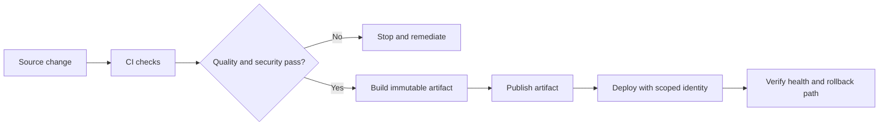

**Question:** “Which checks should fail fast, which steps need cloud credentials, and which credentials must never be committed to Git?”

---

# Module 1 — OIDC and Azure Workload Identity (25 minutes)

**Mode:** Live demonstration. 
**Target:** Explain the protocol, then trace a pod's access to Key Vault and Blob Storage without a stored client secret.

## 1.1 OIDC: what it is and what it is not

- **OpenID Connect (OIDC)** is an identity layer built on top of OAuth 2.0. 
- OAuth 2.0 is primarily an authorization framework.
- OIDC standardizes how a client learns who authenticated, typically via an **ID token**. 
- An ID token is intended for the client to establish identity. 
- An **access token** is presented to a resource/API and conveys authorization context. 
- **Do not casually interchange the two.**

Key terms:

- **Identity Provider (IdP):** authenticates an identity and issues tokens; 
  - in this lab, Microsoft Entra ID is the token issuer for Azure resource access.
- **Issuer (`iss`):** identifies the trusted token issuer.
- **Subject (`sub`):** identifies the principal in the token. 
  - Federation policies often pin the exact subject.
- **Audience (`aud`):** identifies the recipient for which a token is intended. 
  - For Azure workload identity federation, the exchange audience is commonly `api://AzureADTokenExchange`.
- **Claims:** signed attributes such as issuer, subject, audience, timestamps, and identity-related fields.
- **Federation/trust:** the receiving identity provider validates that the presented token's issuer, subject, and audience match a configured trust relationship.
- **Scopes/roles:** determine what the resulting access token can do against a resource. Successful authentication does not automatically grant access to Key Vault or Storage.

### OIDC at a high level

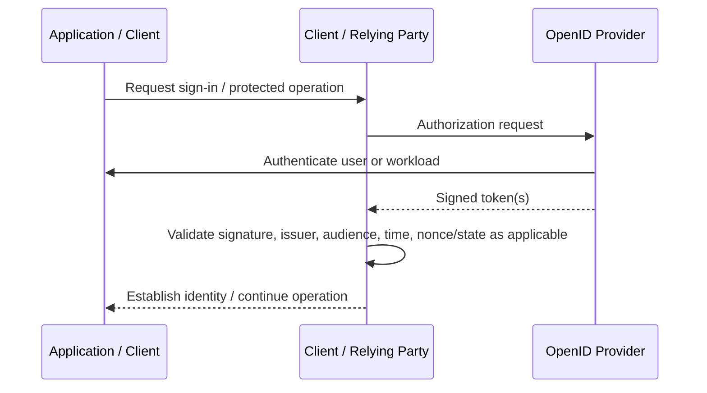

For a machine workload, the trust handshake may be federated rather than an interactive browser login. The core lesson is still **validate a trusted issuer and token claims, then separately enforce resource permissions**.

## 1.2 AKS Workload Identity: the real use case

A conventional anti-pattern is to put a service-principal client secret or Storage Account key in a Kubernetes Secret, environment variable, ConfigMap, or image. 

The value can leak through manifests, logs, backups, accidental `kubectl get -o yaml`, image layers, or repository history. 

Kubernetes Secrets also need correct encryption, RBAC, and operational controls; encoding is not encryption.

With **Microsoft Entra Workload ID for AKS**, the pod uses a Kubernetes service account identity, a projected short-lived service-account token, and a federated identity credential on a user-assigned managed identity. 

The pod does **not** need a long-lived Azure client secret.

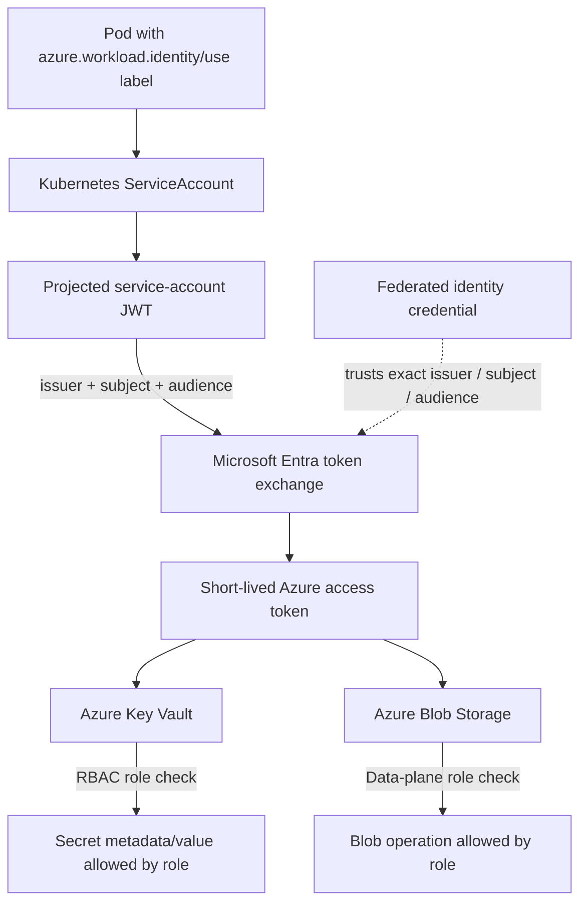

The three controls to emphasize:

1. **Federation trust:** the service account token must match the configured issuer, subject, and audience.
2. **Identity selection:** the Kubernetes service account is associated with the user-assigned managed identity's client ID.
3. **Least privilege:** assign only roles such as `Key Vault Secrets User` at the intended vault scope and `Storage Blob Data Contributor` at the intended Storage Account/container scope. Azure resource `Contributor` on a subscription is not a substitute for data-plane access.

### 1.3 Check cluster readiness

Use the existing training cluster; these commands are for the trainer or cluster administrator. Replace the example names once in the shell before class.

**Set the resource group and AKS cluster name for the following checks.**

```bash
export RESOURCE_GROUP="rg-lab-revise"
```

**Set the AKS cluster name.**

```bash
export CLUSTER_NAME="aks-training-shared"
```

**Inspect whether the OIDC issuer and workload identity features are enabled.**

```bash
az aks show --resource-group "$RESOURCE_GROUP" --name "$CLUSTER_NAME" --query '{oidcIssuer:oidcIssuerProfile.issuerUrl,workloadIdentity:securityProfile.workloadIdentity.enabled}' --output json
```

**If the cluster is not configured yet, enable OIDC issuer and Workload Identity.**

```bash
az aks update --resource-group "$RESOURCE_GROUP" --name "$CLUSTER_NAME" --enable-oidc-issuer --enable-workload-identity
```

**Retrieve the OIDC issuer URL; the federation credential must use this exact issuer.**

```bash
export OIDC_ISSUER="$(az aks show --resource-group "$RESOURCE_GROUP" --name "$CLUSTER_NAME" --query oidcIssuerProfile.issuerUrl --output tsv)"
```

### 1.4 Create or identify the user-assigned managed identity

For a prepared class, the managed identity can already exist. The following commands demonstrate how to create one in a dedicated lab resource group.

**Set the managed identity's name.**

```bash
export IDENTITY_NAME="id-aks-workload-demo"
```

**Set the Azure region used by the lab resources.**

```bash
export LOCATION="eastus"
```

**Create a user-assigned managed identity.**

```bash
az identity create --resource-group "$RESOURCE_GROUP" --name "$IDENTITY_NAME" --location "$LOCATION"
```

**Read the client ID that the Kubernetes service account will reference.**

```bash
export CLIENT_ID="$(az identity show --resource-group "$RESOURCE_GROUP" --name "$IDENTITY_NAME" --query clientId --output tsv)"
```

**Read the identity's principal/object ID for role assignments.**

```bash
export PRINCIPAL_ID="$(az identity show --resource-group "$RESOURCE_GROUP" --name "$IDENTITY_NAME" --query principalId --output tsv)"
```

**Read the current Azure subscription ID.**

```bash
export SUBSCRIPTION_ID="$(az account show --query id --output tsv)"
```

**Read the Microsoft Entra tenant ID.**

```bash
export TENANT_ID="$(az account show --query tenantId --output tsv)"
```

### 1.5 Grant only the required data-plane permissions

Assume the Key Vault and Storage Account already exist. Scope each role assignment to the actual resource; do not use subscription scope for a classroom convenience shortcut.

**Set the demo Key Vault name.**

```bash
export KEYVAULT_NAME="kv-devops-demo-unique"
```

**Set the demo Storage Account name.**

```bash
export STORAGE_ACCOUNT_NAME="stdevopsdemounique"
```

**Set the resource group containing the demo Storage Account; this may differ from the AKS resource group.**

```bash
export STORAGE_RESOURCE_GROUP="$RESOURCE_GROUP"
```

**Build the Key Vault resource ID used as the role-assignment scope.**

```bash
export KEYVAULT_SCOPE="$(az keyvault show --name "$KEYVAULT_NAME" --query id --output tsv)"
```

**Grant permission to read secrets from this vault (not to manage the vault itself).**

```bash
az role assignment create --assignee-object-id "$PRINCIPAL_ID" --assignee-principal-type ServicePrincipal --role "Key Vault Secrets User" --scope "$KEYVAULT_SCOPE"
```

**Build the Storage Account resource ID used as the blob data-plane scope.**

```bash
export STORAGE_SCOPE="$(az storage account show --resource-group "$STORAGE_RESOURCE_GROUP" --name "$STORAGE_ACCOUNT_NAME" --query id --output tsv)"
```

**Grant blob data access at the Storage Account scope; narrow it to a container in production when operationally practical.**

```bash
az role assignment create --assignee-object-id "$PRINCIPAL_ID" --assignee-principal-type ServicePrincipal --role "Storage Blob Data Contributor" --scope "$STORAGE_SCOPE"
```

**Note:** Azure role assignments can take time to propagate. A failure immediately after assignment does not necessarily mean the federation setup is wrong.

### 1.6 Create the federated credential

A federated identity credential binds the AKS OIDC issuer to a specific Kubernetes subject. In this example, the subject is `system:serviceaccount:workload-demo:azure-access`; a namespace or service-account name mismatch will cause token exchange to fail.

**Set the Kubernetes namespace used by the lab.**

```bash
export K8S_NAMESPACE="workload-demo"
```

**Create the dedicated namespace for this demonstration.**

```bash
kubectl create namespace "$K8S_NAMESPACE"
```

**Create a federated credential that trusts only the expected service-account identity.**

```bash
az identity federated-credential create --name "fic-aks-workload-demo" --identity-name "$IDENTITY_NAME" --resource-group "$RESOURCE_GROUP" --issuer "$OIDC_ISSUER" --subject "system:serviceaccount:${K8S_NAMESPACE}:azure-access" --audiences "api://AzureADTokenExchange"
```

### 1.7 Service account and pod wiring

Save the following as `service-account.yaml`, replacing the placeholder with the managed identity's client ID. The service account annotation selects the identity; the **pod-template label** opts the workload into Azure Workload Identity mutation. Both details matter.

```yaml
apiVersion: v1
kind: ServiceAccount
metadata:
  name: azure-access
  namespace: workload-demo
  annotations:
    azure.workload.identity/client-id: "<USER_ASSIGNED_MANAGED_IDENTITY_CLIENT_ID>"
    azure.workload.identity/tenant-id: "<MICROSOFT_ENTRA_TENANT_ID>"
---
apiVersion: v1
kind: Pod
metadata:
  name: workload-identity-smoke-test
  namespace: workload-demo
  labels:
    azure.workload.identity/use: "true"
spec:
  serviceAccountName: azure-access
  restartPolicy: Never
  containers:
    - name: az-cli
      image: mcr.microsoft.com/azure-cli:latest
      command: ["/bin/sh", "-c"]
      args:
        - |
          set -eu
          az login --service-principal \
            --username "$AZURE_CLIENT_ID" \
            --tenant "$AZURE_TENANT_ID" \
            --federated-token "$(cat "$AZURE_FEDERATED_TOKEN_FILE")" \
            --allow-no-subscriptions
          az keyvault secret show --vault-name "$KEYVAULT_NAME" --name "$KEYVAULT_SECRET_NAME" --query id --output tsv
          az storage blob list --account-name "$STORAGE_ACCOUNT_NAME" --container-name "$BLOB_CONTAINER_NAME" --auth-mode login --query '[].name' --output tsv
          sleep 3600
      env:
        - name: KEYVAULT_NAME
          value: "kv-devops-demo-unique"
        - name: KEYVAULT_SECRET_NAME
          value: "class-demo-secret"
        - name: STORAGE_ACCOUNT_NAME
          value: "stdevopsdemounique"
        - name: BLOB_CONTAINER_NAME
          value: "training"
```

This smoke test prints the Key Vault secret's **resource ID**, not its value, and lists blob names. In a real application, use the Azure Identity SDK (for example, `DefaultAzureCredential`) and the Key Vault/Blob SDK rather than embedding `az login` shell calls in the workload. Resource names are configuration, not credentials. The projected federated token is short-lived and injected at runtime.

**Apply the service account and smoke-test pod manifest.**

```bash
kubectl apply -f service-account.yaml
```

**Inspect the pod's startup and authentication output.**

```bash
kubectl logs --namespace workload-demo workload-identity-smoke-test
```

**Confirm the pod received the expected workload-identity environment variables without printing the token itself.**

```bash
kubectl exec --namespace workload-demo workload-identity-smoke-test -- printenv AZURE_CLIENT_ID AZURE_TENANT_ID AZURE_FEDERATED_TOKEN_FILE
```

### 1.8 Troubleshooting matrix

| Symptom | Likely cause | First checks |
|---|---|---|
| Token exchange / `AADSTS` failure | issuer, subject, audience, or client ID mismatch | Compare issuer URL and `system:serviceaccount:<namespace>:<name>` exactly |
| `Key Vault` 403 | missing/wrong Key Vault data-plane role or wrong scope | Check role assignment and whether vault uses Azure RBAC or access policies |
| Blob 403 | blob data role missing, wrong account/container, or token not logged in | Check `Storage Blob Data Contributor` and `--auth-mode login` |
| `AZURE_FEDERATED_TOKEN_FILE` absent | pod label missing or webhook mutation not active | Label the pod template `azure.workload.identity/use: "true"`; inspect pod spec/events |
| Works eventually but fails right after setup | role assignment propagation delay | Retry after propagation; do not broaden permissions reflexively |

**Checkpoint (2 min):** Explain which component authenticates the pod, which configuration establishes trust, and which resource role authorizes a blob read.

---

# Module 2 — SonarQube and Code Quality (30 minutes)

**Mode:** Live demonstration plus a short follow-along on the pipeline YAML. 
**Goal:** Turn a code change into a quality-gate decision and teach students to read the evidence, not just the green/red badge.

## 2.1 Concepts to teach

- **Static analysis:** inspects source code without executing the application, looking for patterns associated with defects, maintainability issues, and security risks.
- **Bug:** a pattern likely to produce incorrect behavior.
- **Vulnerability / security hotspot:** potential security issue; a hotspot usually requires human review rather than being a confirmed exploitable bug by itself.
- **Code smell:** maintainability concern that increases complexity or makes code harder to understand/change. A smell is not automatically a runtime bug.
- **Test coverage:** an indicator of how much code is exercised by tests. Coverage does not prove correctness; a test may execute a line without asserting the right behavior.
- **Quality Gate:** a policy composed of conditions. The analysis can succeed technically while the Quality Gate fails. The gate answers, “Does this change meet our agreed quality policy?”
- **New code vs. overall code:** gating on new code helps teams improve incrementally without requiring all legacy issues to be fixed before every merge.

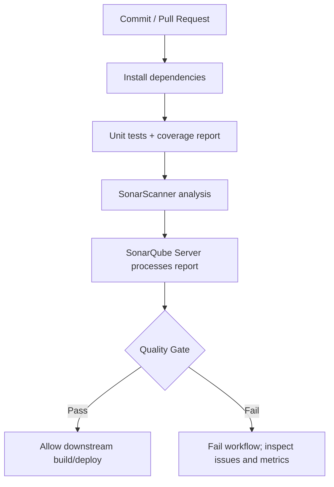

## 2.2 Prepare the self-hosted SonarQube project

Before the class, create a SonarQube project with key `react-quality-lab` (or consistently replace it), create an analysis token, and choose a Quality Gate. For teaching, consider a policy such as “coverage on new code at least 70%” and “no new blocker/critical issues,” adjusting conditions to the server edition and policy options available to your instance.

**Important connectivity point:** the scanner runs on a GitHub Actions runner and sends analysis to SonarQube. A private server requires a runner with network access, VPN connectivity, or another deliberately secured access path. Avoid making an internal analysis service publicly accessible without authentication/TLS and appropriate network controls.

### Optional self-hosted install note

For a one-day lab, use a prebuilt instance rather than spending class time operating SonarQube. If you run it with containers, provision a supported PostgreSQL database, persistent volumes, adequate memory, and the kernel settings required by the bundled search engine. Do not treat an ephemeral single-container local setup as a production design; consult the official SonarQube Server deployment documentation for version-specific requirements.

## 2.3 Minimal sample project

Use a tiny Node/Jest project so students can understand the coverage report. Repository layout:

```text
sonar-lab/
├── .github/workflows/sonar.yml
├── sonar-project.properties
├── package.json
├── src/discount.js
└── tests/discount.test.js
```

`package.json`:

```json
{
  "name": "sonar-quality-lab",
  "version": "1.0.0",
  "private": true,
  "description": "Training project for SonarQube analysis",
  "scripts": {
    "test": "jest --coverage --runInBand"
  },
  "devDependencies": {
    "jest": "^30.0.0"
  }
}
```

`src/discount.js` — intentionally a little repetitive, to give the class something to inspect:

```javascript
function calculateTotal(price, isMember) {
  var discount = 0;

  if (isMember) {
    if (price > 100) {
      discount = 0.15;
    } else {
      discount = 0.1;
    }
  } else {
    if (price > 100) {
      discount = 0.05;
    } else {
      discount = 0;
    }
  }

  return price - price * discount;
}

module.exports = { calculateTotal };
```

`tests/discount.test.js`:

```javascript
const { calculateTotal } = require('../src/discount');

test('member receives 15% discount above 100', () => {
  expect(calculateTotal(200, true)).toBe(170);
});

test('member receives 10% discount at or below 100', () => {
  expect(calculateTotal(80, true)).toBe(72);
});

test('non-member receives 5% discount above 100', () => {
  expect(calculateTotal(200, false)).toBe(190);
});

test('non-member receives no discount at or below 100', () => {
  expect(calculateTotal(80, false)).toBe(80);
});
```

**Install Jest and generate a lockfile so the workflow can use reproducible `npm ci` installs.**

```bash
npm install
```

**Run the tests and emit an LCOV coverage report before pushing.**

```bash
npm test
```

Students should confirm `coverage/lcov.info` exists. The scanner imports this report; it does not automatically invent coverage data simply by analyzing the source.

## 2.4 SonarQube project configuration

Save this as `sonar-project.properties`, adjusting `sonar.projectKey` to match the project created on the server.

```properties
sonar.projectKey=react-quality-lab
sonar.projectName=React Quality Lab
sonar.sources=src
sonar.tests=tests
sonar.javascript.lcov.reportPaths=coverage/lcov.info
sonar.qualitygate.wait=true
sonar.qualitygate.timeout=300
```

`sonar.qualitygate.wait=true` tells the scanner to wait for the server-side Quality Gate result and return a failing exit code if the gate fails. This adds pipeline time but makes the decision actionable in CI.

## 2.5 GitHub Actions workflow

Save this as `.github/workflows/sonar.yml`. Add `SONAR_TOKEN` as an Actions secret and `SONAR_HOST_URL` as an Actions variable. Use a SonarQube-compatible scanner action version and keep action versions reviewed/pinned in production.

```yaml
name: SonarQube Code Quality

on:
  push:
    branches: [main]
  pull_request:
    branches: [main]

permissions:
  contents: read

jobs:
  analyze:
    name: Test and analyze
    runs-on: ubuntu-latest
    steps:
      - name: Check out source
        uses: actions/checkout@v7

      - name: Set up Node.js
        uses: actions/setup-node@v7
        with:
          node-version: 22
          cache: npm

      - name: Install locked dependencies
        run: npm ci

      - name: Run tests and generate LCOV coverage
        run: npm test

      - name: Analyze with SonarQube Server
        uses: SonarSource/sonarqube-scan-action@v8.3.0
        env:
          SONAR_TOKEN: ${{ secrets.SONAR_TOKEN }}
          SONAR_HOST_URL: ${{ vars.SONAR_HOST_URL }}
```

This workflow intentionally has one shell command per `run:` step. Keep the Sonar token out of command-line arguments and source control. If SonarQube uses a private CA, install/trust that CA on the runner or configure the scanner's supported certificate setting; do not work around TLS verification by disabling certificate checks. GitHub does not expose repository secrets to workflows triggered from forks, so either skip the secret-dependent scan for fork pull requests or run it on a secured self-hosted runner under a carefully reviewed trust model.

## 2.6 Demonstration steps and expected observations

**Step A — push the starter version.** Explain the job order: checkout → runtime setup → deterministic install → tests/report → scan → server-side gate result.

**Step B — inspect the workflow log.** Verify tests pass and the scanner uploads an analysis report. A scanner upload message alone is not proof that the Quality Gate passed.

**Step C — open the SonarQube project.** Review:

- the Quality Gate status and which condition passed/failed;
- coverage and the timestamp/source of the imported LCOV report;
- new issues vs. overall issues;
- code smells and the issue's rule explanation/remediation guidance;
- the analysis background task status if results are delayed.

**Step D — change one thing.** Remove/alter a branch without updating tests, or add a simple code path and fail to test it. Push the change and predict the outcome before reading the new report. Then refactor the repetitive discount logic (e.g., reduce nesting and use `const` where possible), update tests if behavior changes, and compare the new-code metrics.

**Avoid promising a specific smell count:** the exact issues depend on SonarQube version, language analyzer, Quality Profile, and rules enabled on the instance. Teach students to inspect the actual rule and evidence.

### Common failure modes

| Symptom | Cause/check |
|---|---|
| Scanner cannot connect | Incorrect host URL, DNS/firewall path, proxy, TLS trust, or runner outside the private network |
| “Not authorized” | Bad token, expired/revoked token, or token for a different instance/project |
| Coverage stays 0% / missing | `npm test` did not create LCOV, report path mismatch, or test/source paths misconfigured |
| Analysis succeeds but gate is red | Technical analysis succeeded; one or more policy conditions failed |
| PR result differs from branch analysis | PR analysis support and decoration depend on SonarQube edition/configuration and GitHub integration |

**Checkpoint (2 min):** Students must distinguish a scanner execution failure from a Quality Gate failure and explain why “80% coverage” is not the same as “80% correctness.”

---

# Module 3 — Kubernetes RBAC and kubeconfig (25 minutes)

**Mode:** Follow-along lab. 
**Goal:** Create a read-only namespaced permission and explain how the client authenticates to AKS.

## 3.1 The four RBAC objects

Kubernetes authorization is based on subjects, rules, and bindings:

- **Role:** permissions within one namespace.
- **ClusterRole:** permissions at cluster scope, or reusable rules that can also be bound within a namespace.
- **RoleBinding:** grants a Role or ClusterRole's rules within one namespace to users, groups, or service accounts.
- **ClusterRoleBinding:** grants a ClusterRole across the cluster.

Kubernetes RBAC is additive. There are no explicit “deny” rules in standard RBAC; a subject's effective permissions are the union of applicable grants. Use the smallest verbs/resources/scope that satisfy the task.

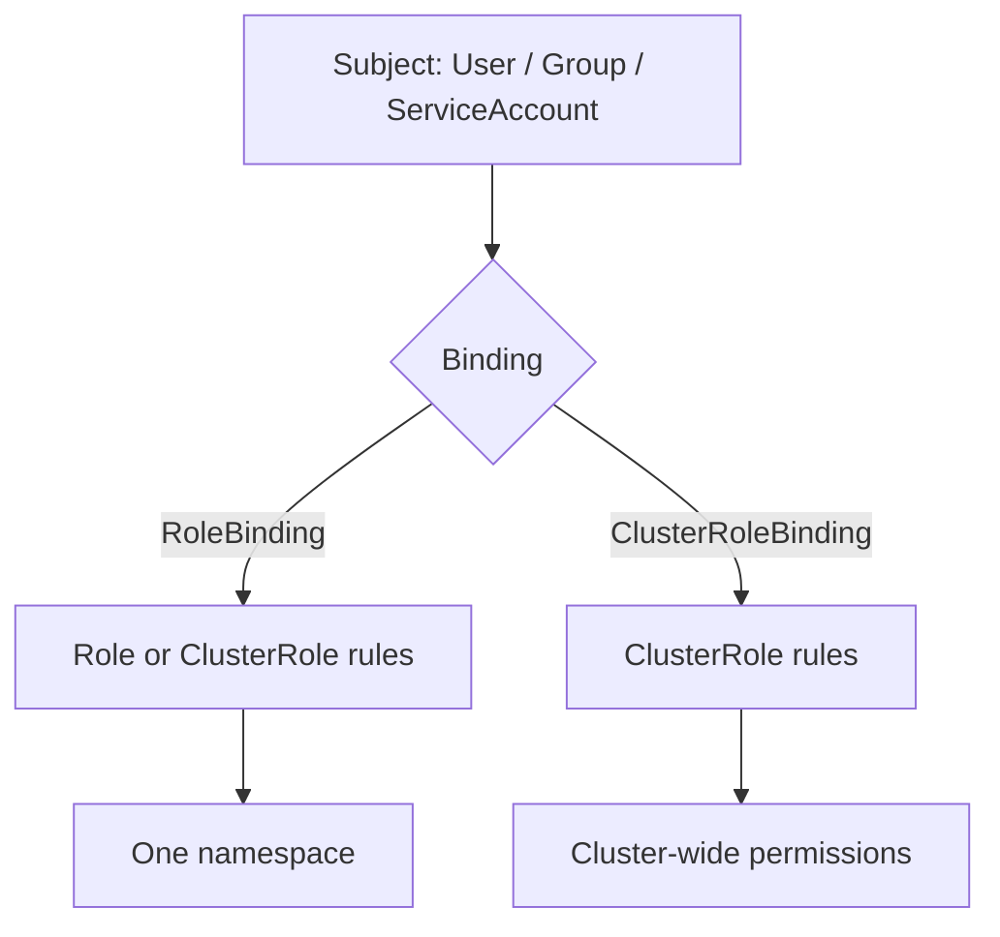

### Example object choice

| Need | Recommended starting point |
|---|---|
| Let a service account list pods in `demo` | `Role` + `RoleBinding` in `demo` |
| Let a platform engineer read nodes across the cluster | `ClusterRole` + `ClusterRoleBinding`, after policy review |
| Reuse a standard read-only rule set in several namespaces | `ClusterRole` + separate `RoleBinding`s in those namespaces |
| Grant permissions across all namespaces | `ClusterRoleBinding` only when truly required |

## 3.2 Hands-on lab: a service account that can only read pods

**Create a lab namespace.**

```bash
kubectl create namespace rbac-demo
```

Save the following as `rbac-readonly.yaml`. Notice that the rule grants only `get`, `list`, and `watch` on core API `pods`; it does not grant write access, access to Secrets, or permission to `exec` into containers.

```yaml
apiVersion: v1
kind: ServiceAccount
metadata:
  name: pod-reader
  namespace: rbac-demo
---
apiVersion: rbac.authorization.k8s.io/v1
kind: Role
metadata:
  name: pod-reader
  namespace: rbac-demo
rules:
  - apiGroups: [""]
    resources: ["pods"]
    verbs: ["get", "list", "watch"]
---
apiVersion: rbac.authorization.k8s.io/v1
kind: RoleBinding
metadata:
  name: pod-reader-binding
  namespace: rbac-demo
subjects:
  - kind: ServiceAccount
    name: pod-reader
    namespace: rbac-demo
roleRef:
  apiGroup: rbac.authorization.k8s.io
  kind: Role
  name: pod-reader
```

**Apply the service account, Role, and RoleBinding.**

```bash
kubectl apply -f rbac-readonly.yaml
```

**Ask the API server whether the service account can list pods in the namespace.**

```bash
kubectl auth can-i list pods --namespace rbac-demo --as system:serviceaccount:rbac-demo:pod-reader
```

**Confirm that the same subject cannot delete pods.**

```bash
kubectl auth can-i delete pods --namespace rbac-demo --as system:serviceaccount:rbac-demo:pod-reader
```

**Confirm that the subject cannot read Secrets.**

```bash
kubectl auth can-i get secrets --namespace rbac-demo --as system:serviceaccount:rbac-demo:pod-reader
```

Expected results are `yes`, `no`, and `no` respectively, assuming the impersonating user running `kubectl auth can-i` has permission to impersonate the service account. If impersonation itself is forbidden, use an appropriately authorized lab-admin context; do not widen the student's Role just to make the test command work.

### Follow-along challenge

Add `configmaps` to the resource list but not `secrets`, rerun the check, and explain why the RoleBinding's namespace limits the grant. Then discuss why binding a broad `cluster-admin` ClusterRole to an application service account is a serious privilege-escalation risk.

## 3.3 kubeconfig anatomy

A kubeconfig file tells `kubectl` which cluster/API endpoint to contact, what identity/authentication mechanism to use, and which context is the current default. Common elements:

- `clusters`: API server endpoint and optional CA certificate data.
- `users` (also called `authInfos` in the API model): client certificate/key, token, or an `exec` credential plugin configuration.
- `contexts`: a pairing of a cluster, user, and optional namespace.
- `current-context`: the context used by default.
- `preferences` and extensions: optional client settings/additional metadata.

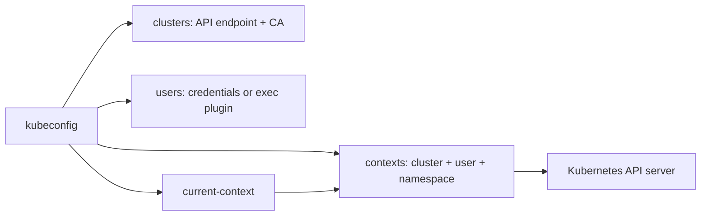

**Inspect the current context name.**

```bash
kubectl config current-context
```

**List contexts available in the merged kubeconfig.**

```bash
kubectl config get-contexts
```

**Show the current context and connection details; be careful before sharing output publicly.**

```bash
kubectl config view --minify
```

**Read the current context's cluster and user references without printing secret material.**

```bash
kubectl config view --minify -o jsonpath='{.contexts[0].context.cluster}{"\n"}{.contexts[0].context.user}{"\n"}'
```

## 3.4 Static kubeconfig vs. AKS dynamic kubeconfig

### Standard/static style

A kubeconfig can contain a bearer token, client certificate/key, or other static credential material. Static credentials can be easy to use but require secure distribution, rotation, storage, and revocation. A long-lived token copied into multiple machines is a credential-management problem. Never commit real kubeconfigs or private keys.

### AKS + Microsoft Entra + `kubelogin` exec plugin

For modern AKS clusters (Kubernetes 1.24+), `az aks get-credentials` typically writes an **exec-plugin** based kubeconfig for Microsoft Entra authentication. Instead of storing a long-lived Azure password or static Kubernetes token in the file, the config tells `kubectl` to invoke `kubelogin` when credentials are needed. `kubelogin` obtains a Microsoft Entra token using a configured authentication flow/cache (for example, Azure CLI's logged-in session), then `kubectl` presents the access token to the API server. AKS authentication answers who the caller is; Kubernetes RBAC or Azure RBAC for Kubernetes authorization determines what that identity may do.

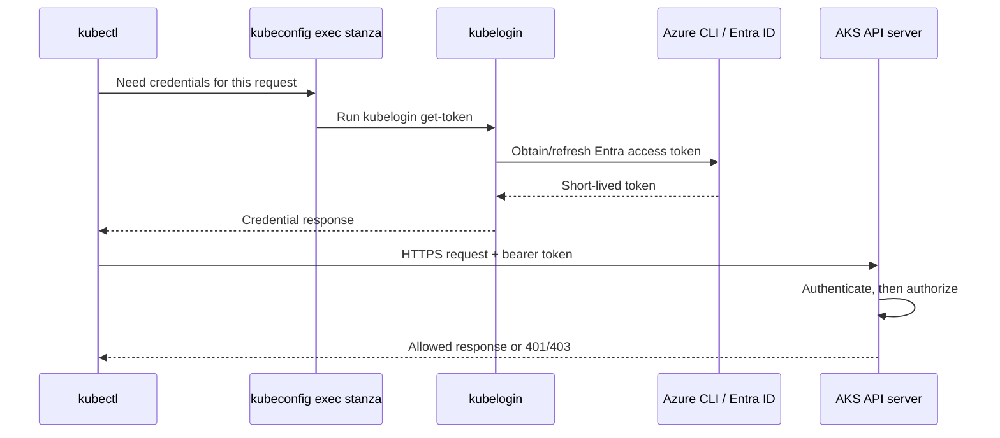

**Fetch/merge AKS user credentials into kubeconfig.**

```bash
az aks get-credentials --resource-group "$RESOURCE_GROUP" --name "$CLUSTER_NAME"
```

**Inspect the exec stanza without requesting admin credentials.**

```bash
kubectl config view --minify --raw=false
```

**Check the kubelogin version installed on the client.**

```bash
kubelogin --version
```

**If the kubeconfig needs converting to use the current Azure CLI sign-in, run the following; this changes the local kubeconfig authentication stanza.**

```bash
kubelogin convert-kubeconfig -l azurecli
```

**Verify the signed-in Azure CLI account before testing AKS access.**

```bash
az account show --output table
```

Important distinctions:

- `az aks get-credentials` retrieves cluster connection information and an authentication configuration; it does not itself grant Kubernetes permissions.
- `kubelogin` is a client-side credential plugin; it is not a Kubernetes authorization engine.
- A user may authenticate successfully and still receive `Forbidden` if RBAC does not grant the requested action.
- Avoid `az aks get-credentials --admin` for normal development. Admin credentials bypass the normal Entra user/RBAC path and should be tightly restricted.

**Checkpoint (2 min):** Diagnose `Unauthorized` (authentication/credential path) versus `Forbidden` (authenticated but not authorized) and point to the corresponding kubeconfig component.

---

# Modules 4 & 5 — Terraform CI/CD and Workspaces (45 minutes)

**Mode:** Follow-along lab; trainer performs the first apply while students review the plan. 
**Goal:** Validate infrastructure code, isolate state by workspace, apply safely through GitHub Actions, and observe idempotency.

## 4.1 What Terraform workspaces ares and are not

Terraform CLI workspaces are separate state instances associated with one working directory and configuration. 

A new workspace does **not** create a new source-code directory or automatically provide separate credentials, policy boundaries, or cloud accounts. 

Each workspace should deploy non-overlapping resource sets, and configuration should deliberately vary names/settings by workspace.

- `default` exists automatically.
- `terraform workspace new` creates and selects a workspace.
- `terraform workspace select` switches the active workspace.
- Terraform commands act on the selected workspace's state.
- Workspaces can be useful for lightweight environment copies, but HashiCorp recommends other patterns when stronger isolation, distinct credentials, or complex environment boundaries are required.

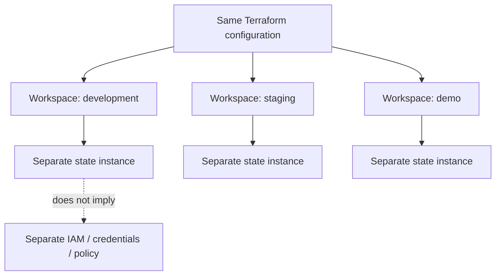

For production systems with strict separation, consider separate root modules/directories, distinct backend keys or state storage, separate cloud subscriptions/accounts, and separate deployment identities. 

**Do not rely on workspace name alone as a security boundary.**

## 4.2 Create and switch workspaces locally

Run commands from the root of the prepared Terraform directory.

**Initialize the Terraform directory and download providers.**

```bash
terraform init
```

**List available workspaces and identify the active one.**

```bash
terraform workspace list
```

**Create and switch to a development workspace.**

```bash
terraform workspace new development
```

**Switch to a staging workspace (create it first if it doesn't exist).**

```bash
terraform workspace select -or-create staging
```

**Print the currently selected workspace.**

```bash
terraform workspace show
```

**Return to development before applying the initial lab deployment.**

```bash
terraform workspace select development
```

### State backend prerequisite

For local practice, Terraform's local state is acceptable in a disposable sandbox. 

**CI must use persistent remote state** with locking and restricted access. 

GitHub-hosted runners are ephemeral, so a local state file disappears after the job and the next run could try to recreate resources or lose the link between configuration and real resources.

This class assumes the Azure Blob remote-state backend has already been bootstrapped in a separate Storage Account. It should not be the same account being created by the exercise. Enable blob versioning and recovery features, restrict `Storage Blob Data Contributor` to the CI identity for the state container, and protect state files as sensitive data (state can contain sensitive attributes).

## 4.3 Terraform configuration: an Azure Storage Account and blob container

Use a **pre-created target resource group** so the CI principal can be scoped to that resource group instead of being granted broad subscription Contributor access. The state backend is separate.

Repository layout:

```text
terraform-storage-lab/
├── .github/workflows/terraform.yml
├── backend.tf
├── main.tf
├── variables.tf
├── outputs.tf
└── .tflint.hcl
```

### `backend.tf`

Replace the example backend names with the pre-created state resources. `use_azuread_auth = true` tells the AzureRM backend to use Microsoft Entra authentication for Blob data-plane access.

```hcl
terraform {
  required_version = ">= 1.9.0, < 2.0.0"

  required_providers {
    azurerm = {
      source  = "hashicorp/azurerm"
      version = "~> 4.0"
    }
    random = {
      source  = "hashicorp/random"
      version = "~> 3.6"
    }
  }

  backend "azurerm" {
    resource_group_name  = "rg-tfstate-training"
    storage_account_name = "sttfstatetraining123"
    container_name       = "tfstate"
    key                  = "storage-lab.tfstate"
    use_azuread_auth     = true
  }
}
```

### `variables.tf`

```hcl
variable "subscription_id" {
  description = "Azure subscription used by this deployment."
  type        = string
}

variable "target_resource_group_name" {
  description = "Pre-created resource group receiving the demo Storage Account."
  type        = string
}

```

### `main.tf`

The Storage Account name combines a workspace-derived slug and a random suffix. Azure Storage Account names are globally unique, 3–24 characters, lowercase letters/numbers only. Random suffixes reduce collisions; they do not guarantee global uniqueness. Each workspace has its own Terraform state and therefore its own random resource instance.

```hcl
provider "azurerm" {
  features {}
  subscription_id = var.subscription_id
}

data "azurerm_resource_group" "target" {
  name = var.target_resource_group_name
}

resource "random_string" "suffix" {
  length  = 6
  upper   = false
  special = false
  numeric = true
  lower   = true
}

locals {
  workspace_slug = substr(replace(lower(terraform.workspace), "/[^a-z0-9]/", ""), 0, 8)
  storage_name   = substr("st${local.workspace_slug}${random_string.suffix.result}", 0, 24)
}

resource "azurerm_storage_account" "demo" {
  name                            = local.storage_name
  resource_group_name             = data.azurerm_resource_group.target.name
  location                        = data.azurerm_resource_group.target.location
  account_tier                    = "Standard"
  account_replication_type        = "LRS"
  min_tls_version                 = "TLS1_2"
  https_traffic_only_enabled      = true
  allow_nested_items_to_be_public = false

  tags = {
    environment = terraform.workspace
    managed_by  = "terraform"
    purpose     = "devops-training"
    cost_center = "training"
  }
}

resource "azurerm_storage_container" "demo" {
  name                  = "training"
  storage_account_id    = azurerm_storage_account.demo.id
  container_access_type = "private"
}
```

This is a teaching baseline, not a complete production storage design. A real production workload may need private endpoints, network ACLs, diagnostic settings, immutability/retention, explicit data-plane identity strategy, redundancy decisions, and centralized policies. Do not use the account name or tags as an access-control boundary.

### `outputs.tf`

```hcl
output "storage_account_name" {
  description = "Workspace-specific Storage Account name."
  value       = azurerm_storage_account.demo.name
}

output "blob_endpoint" {
  description = "Primary Blob endpoint of the created account."
  value       = azurerm_storage_account.demo.primary_blob_endpoint
}
```

### `.tflint.hcl`

```hcl
config {
  call_module_type = "local"
  force            = false
}
```

### Bootstrap the lab resource groups and backend

The deployment resource group and remote-state Storage Account/container must exist before running the workflow. Prepare these once under a trainer/admin identity, then scope student access appropriately.

**Set the lab region.**

```bash
export LOCATION="eastus"
```

**Create the resource group for resources provisioned by the classroom Terraform code.**

```bash
az group create --name "rg-terraform-demo" --location "$LOCATION"
```

**Create a separate resource group to hold Terraform state.**

```bash
az group create --name "rg-tfstate-training" --location "$LOCATION"
```

**Create a globally unique, lowercase Storage Account for the remote state backend; change the name if Azure reports a collision and use the chosen name in `backend.tf`.**

```bash
az storage account create --name "sttfstatetraining123" --resource-group "rg-tfstate-training" --location "$LOCATION" --sku Standard_LRS --kind StorageV2 --min-tls-version TLS1_2 --https-only true
```

**Create the private blob container used for state; the signed-in administrator needs Blob data-plane permission.**

```bash
az storage container create --name "tfstate" --account-name "sttfstatetraining123" --auth-mode login
```

**Enable blob versioning on the state account so state changes can be recovered.**

```bash
az storage account blob-service-properties update --resource-group "rg-tfstate-training" --account-name "sttfstatetraining123" --enable-versioning true
```

**Check the deployment resource group's resource ID before assigning a scoped role.**

```bash
az group show --name "rg-terraform-demo" --query id --output tsv
```

**Assign the Terraform deployment identity Contributor only on the target resource group (replace the client/object ID with the identity's principal object ID as appropriate).**

```bash
az role assignment create --assignee-object-id "<TERRAFORM_PRINCIPAL_OBJECT_ID>" --assignee-principal-type ServicePrincipal --role Contributor --scope "<TARGET_RESOURCE_GROUP_RESOURCE_ID>"
```

**Assign the CI identity Blob data access to the state Storage Account (prefer a narrower container-scoped assignment where your governance and operational setup supports it).**

```bash
az role assignment create --assignee-object-id "<TERRAFORM_PRINCIPAL_OBJECT_ID>" --assignee-principal-type ServicePrincipal --role "Storage Blob Data Contributor" --scope "<STATE_STORAGE_ACCOUNT_RESOURCE_ID>"
```

## 4.4 Two-step Terraform CI/CD pipeline

The workflow has two jobs:

1. **Validate:** formatting, provider initialization without backend access, Terraform validation, TFLint, and Checkov. This runs for pull requests and pushes.
2. **Apply:** authenticates to Azure with GitHub OIDC, initializes the persistent remote backend, selects/creates the workspace, and applies only when code is pushed to `main`. Production use should add an environment approval and a separately reviewed plan/apply workflow where required by policy.

### Configure GitHub-to-Azure federation first

Create a Microsoft Entra app/service principal (or another supported federated identity target) and add a federated credential whose subject matches the GitHub repository/branch or the GitHub Environment exactly. For the sample workflow, the trusted subject is `repo:ORG/REPO:ref:refs/heads/main`; replace `ORG/REPO` with the exact path. Grant that identity Contributor on the target resource group and Blob data access to the state backend only. The workflow uses GitHub OIDC; no client secret is required.

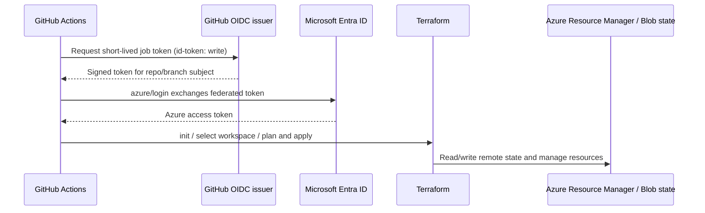

Save as `.github/workflows/terraform.yml`. Before the first run, set `TF_WORKSPACE` to `development` (shown as a workflow env value below), replace the backend settings in `backend.tf`, and create the GitHub variables shown in the prerequisite table. Add branch protection so changes to `main` require review.

```yaml
name: Terraform Azure Storage Lab

on:
  pull_request:
    branches: [main]
  push:
    branches: [main]

permissions:
  contents: read

env:
  TF_IN_AUTOMATION: "true"
  TF_INPUT: "false"
  TF_WORKSPACE: "development"
  TF_VAR_subscription_id: ${{ vars.AZURE_SUBSCRIPTION_ID }}
  TF_VAR_target_resource_group_name: ${{ vars.TF_TARGET_RESOURCE_GROUP }}

jobs:
  validate:
    name: Format, validate, lint, and scan
    runs-on: ubuntu-latest
    steps:
      - name: Check out code
        uses: actions/checkout@v7

      - name: Set up Terraform
        uses: hashicorp/setup-terraform@v4
        with:
          terraform_version: 1.14.6
          terraform_wrapper: false

      - name: Check Terraform formatting
        run: terraform fmt -check -recursive

      - name: Initialize providers without remote backend access
        run: terraform init -backend=false -input=false

      - name: Validate Terraform configuration
        run: terraform validate

      - name: Set up TFLint
        uses: terraform-linters/setup-tflint@v6
        with:
          tflint_version: latest

      - name: Initialize TFLint plugins
        run: tflint --init

      - name: Lint Terraform
        run: tflint --recursive

      - name: Scan Infrastructure as Code with Checkov
        uses: bridgecrewio/checkov-action@v12
        with:
          directory: .
          framework: terraform
          quiet: false
          soft_fail: false

  apply:
    name: Apply on main only
    runs-on: ubuntu-latest
    needs: validate
    if: github.event_name == 'push' && github.ref == 'refs/heads/main'
    permissions:
      contents: read
      id-token: write
    env:
      # These environment variables let the AzureRM provider and backend use GitHub OIDC directly.
      ARM_USE_OIDC: "true"
      ARM_CLIENT_ID: ${{ vars.AZURE_CLIENT_ID }}
      ARM_TENANT_ID: ${{ vars.AZURE_TENANT_ID }}
      ARM_SUBSCRIPTION_ID: ${{ vars.AZURE_SUBSCRIPTION_ID }}
    steps:
      - name: Check out code
        uses: actions/checkout@v7

      - name: Set up Terraform
        uses: hashicorp/setup-terraform@v4
        with:
          terraform_version: 1.14.6
          terraform_wrapper: false

      - name: Authenticate to Azure using GitHub OIDC
        uses: azure/login@v3
        with:
          client-id: ${{ vars.AZURE_CLIENT_ID }}
          tenant-id: ${{ vars.AZURE_TENANT_ID }}
          subscription-id: ${{ vars.AZURE_SUBSCRIPTION_ID }}

      - name: Initialize persistent Azure Blob backend
        run: terraform init -input=false

      - name: Select or create workspace
        run: terraform workspace select -or-create "$TF_WORKSPACE"

      - name: Apply reviewed main-branch configuration
        run: terraform apply -auto-approve -input=false
```

**Operational note on the sample:** The `Checkov` action deliberately blocks the job on failed checks. 

Your installed Checkov policy bundle may require additional controls (for example, network restrictions or diagnostics) beyond this minimal demo; add those controls and keep the gate blocking instead of reflexively setting `soft_fail: true`. 

For production, pin all Actions to full reviewed commit SHAs, enforce a required environment approval for production, and consider a plan artifact with a human approval before apply.

## 4.5 Idempotency and the “only the diff” demonstration

Terraform is declarative. 

It compares configuration, current state, and observed infrastructure, then computes proposed actions.

If the configuration and real infrastructure have not changed, a subsequent plan should typically show **no changes**. 

If a tag changes, Terraform should plan an in-place update rather than recreating the Storage Account, assuming the provider treats that property as updateable.

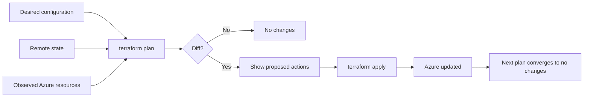

**Check the active workspace before planning; never assume the correct one is selected.**

```bash
terraform workspace show
```

**Create and save a plan so the proposed actions can be inspected before applying.**

```bash
terraform plan -out=tfplan
```

**Render the saved plan in human-readable form.**

```bash
terraform show tfplan
```

**Apply the reviewed saved plan, not a newly recomputed plan.**

```bash
terraform apply tfplan
```

Now change one tag in `main.tf`, for example change `cost_center = "training"` to `cost_center = "classroom"`, and push. 

In the GitHub Actions log, see to identify whether the diff shows an in-place update (`~`) or replacement (`-/+`). 

Because the workflow uses `terraform apply -auto-approve` for the classroom's protected `main` branch, a push directly applies that diff. 

For a real production environment, prefer a reviewed plan/artifact and approval gates rather than relying only on `auto-approve`.

**Show local plan evidence before the pipeline demonstration.**

```bash
terraform plan
```

After the first successful apply, run another plan. It should converge to no changes unless there has been drift or a configuration change.

**Check for drift by refreshing the plan from Azure and comparing it with declared configuration.**

```bash
terraform plan -refresh-only
```

### Troubleshooting Terraform CI

| Symptom | Likely cause | Resolution path |
|---|---|---|
| Backend `403` / cannot list blobs | Wrong identity, missing Blob data role, or wrong backend account/container | Verify GitHub OIDC subject, Azure login output, account/container names, and state-scope assignment |
| `terraform validate` cannot initialize provider | Missing lockfile/provider download issue | Re-run init, commit `.terraform.lock.hcl`, pin provider constraints |
| Storage Account name invalid/collision | Azure naming rules or name already taken | Use lowercase letters/numbers, keep within 3–24 characters, retain a random suffix |
| `terraform apply` tries to recreate resources | Wrong workspace/backend, lost state, state key mismatch, or out-of-band drift | Stop before applying; inspect workspace, backend, state, and plan |
| Checkov blocks the PR | A policy identifies a potentially insecure configuration | Read the specific policy and remediate; suppress only with documented rationale and owner approval |
| A later job does not see earlier state | State is local to a temporary runner | Configure the persistent Azure Blob backend; do not upload raw state artifacts casually |

**Checkpoint (3 min):** Have students describe why a no-change second plan is valuable, why state must be remote in CI, and why workspace separation is not equivalent to separate production security boundaries.

---

# Module 6 — Complete Docker CI/CD Pipeline to an Ubuntu VM (35 minutes)

**Mode:** Live demonstration, then students trace the workflow. 
**Goal:** Build a React app, build/tag a container image, push it to Docker Hub, and deploy that immutable tag to a target VM over SSH.

## 6.1 End-to-end flow

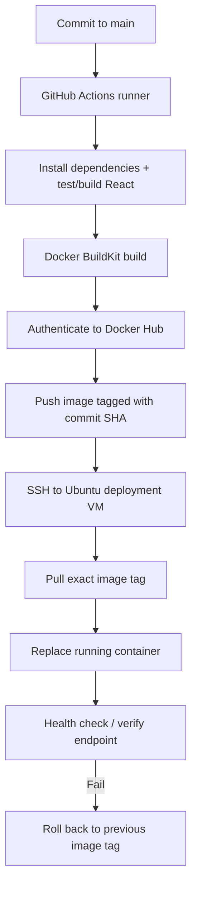

**Important design choices:**

- Build once and promote the same image digest/tag; do not rebuild separately on the target VM.
- Use an immutable commit-SHA tag as the deployment identifier. `latest` is convenient for exploration but ambiguous for rollback/auditing.
- Keep registry credentials, SSH private keys, and target details out of the repository.
- Restrict network access to the VM and use verified SSH host keys.
- For production, deploy behind TLS termination and a reverse proxy/load balancer, add health checks, logs/metrics, and a rollback strategy. This workshop binds the demo container to port `8080` for clarity.

## 6.2 Sample React/Vite app

Create a standard Vite React project in the repository. The generated project contains a `package-lock.json`; commit it and use `npm ci` in CI. Replace `src/App.jsx` with a small demo page.

**Create the starter React project.**

```bash
npm create vite@latest react-training -- --template react
```

**Enter the generated project directory.**

```bash
cd react-training
```

**Install packages and generate/refresh the lockfile.**

```bash
npm install
```

`src/App.jsx`:

```jsx
export default function App() {
  return (
    <main style={{ fontFamily: 'system-ui, sans-serif', padding: '3rem', maxWidth: 760, margin: '0 auto' }}>
      <p style={{ textTransform: 'uppercase', letterSpacing: '.12em', color: '#2563eb', fontWeight: 700 }}>
        DevOps Revision Lab
      </p>
      <h1>React → Docker → Ubuntu VM</h1>
      <p>This page was built in GitHub Actions, published to Docker Hub, and deployed automatically.</p>
      <p><strong>Release identifier:</strong> supplied at build/deploy time in the pipeline log.</p>
    </main>
  );
}
```

**Run the local Vite development server as a quick sanity check.**

```bash
npm run dev -- --host 0.0.0.0
```

**Build the production bundle locally once before the container exercise.**

```bash
npm run build
```

## 6.3 Dockerfile and Nginx configuration

Save this `Dockerfile` at the repository root. It builds the static React assets in a Node.js stage and serves the final `dist` files using Nginx. Multi-stage builds keep build tooling out of the runtime image.

```dockerfile
FROM node:22-alpine AS build
WORKDIR /app
COPY package.json package-lock.json ./
RUN npm ci
COPY . .
RUN npm run build

FROM nginx:alpine AS runtime
COPY nginx.conf /etc/nginx/conf.d/default.conf
COPY --from=build /app/dist /usr/share/nginx/html
EXPOSE 80
HEALTHCHECK --interval=30s --timeout=3s --start-period=5s --retries=3 \
  CMD wget -q -O /dev/null http://127.0.0.1/ || exit 1
```

Save this as `nginx.conf`. The SPA fallback sends unknown paths to `index.html`, which is useful for client-side routing.

```nginx
server {
    listen 80;
    server_name _;
    root /usr/share/nginx/html;
    index index.html;

    location / {
        try_files $uri $uri/ /index.html;
    }

    location /healthz {
        access_log off;
        default_type text/plain;
        return 200 "ok\n";
    }
}
```

Save this `.dockerignore` file so local dependencies and Git metadata are not copied into the build context.

```text
node_modules
.git
.github
coverage
dist
npm-debug.log
```

## 6.4 Prepare the Ubuntu deployment VM

Use a dedicated training VM with Docker installed. Do not deploy into a production VM. The VM should be able to pull the image from Docker Hub and receive SSH from the chosen runner. Use a private IP and a self-hosted runner/bastion where practical; if using a public IP for class, narrowly allowlist the source and close it after the session.

**Refresh the VM's package index.**

```bash
sudo apt-get update
```

**Install Ubuntu's packaged Docker Engine and SSH server for a simple classroom setup.**

```bash
sudo apt-get install -y docker.io openssh-server
```

**Enable Docker to start now and after a VM reboot.**

```bash
sudo systemctl enable --now docker
```

For the classroom, the workflow will connect using a dedicated SSH account and call a root-owned deploy script via narrowly scoped `sudo`. Create that account according to your organization's SSH-key policy; do not use the root account directly.

### VM-side deployment script

Install this script as `/usr/local/sbin/deploy-react-training` and replace `expected_image` with the exact Docker Hub repository, such as `mydockerhubuser/react-training`. 

It accepts only that repository with a 40-character lowercase Git commit SHA tag, pulls the exact image, replaces the named container, and binds the service to the VM's port 8080. 

You may store an image tag from the previous successful deployment to implement an automatic rollback. 

This minimal version leaves rollback to the instructor's manual step.

```bash
#!/usr/bin/env bash
set -Eeuo pipefail

image_ref="${1:?Usage: deploy-react-training <dockerhub-user/react-training:40-char-sha>}"
expected_image="aayushpokharel/react-training"
if [[ "$image_ref" != "$expected_image:"* ]] || [[ ! "$image_ref" =~ ^[a-z0-9._-]+/react-training:[a-f0-9]{40}$ ]]; then
  echo "Invalid image reference or repository; update expected_image in the root-owned script" >&2
  exit 2
fi

docker pull "$image_ref"
docker rm --force react-training 2>/dev/null || true
docker run --detach \
  --name react-training \
  --restart unless-stopped \
  --publish 80:80 \
  "$image_ref"
```

Set ownership and executable permissions, and create a dedicated sudoers rule using `visudo` so the deployment user can execute only this script as root. Do not let the deployment user edit the root-owned script or its parent directory.

**Install the prepared script with root ownership and executable permissions.**

```bash
sudo install -o root -g root -m 0750 deploy-react-training /usr/local/sbin/deploy-react-training
```

Example sudoers rule (save using `visudo -f /etc/sudoers.d/deploy-react-training`, replacing `deploy` with the dedicated deployment username):

```text
deploy ALL=(root) NOPASSWD: /usr/local/sbin/deploy-react-training
```

Be aware that Docker access is effectively root-equivalent. Avoid adding the deployment account to the unrestricted `docker` group as a shortcut if your threat model requires least privilege.

**Verify Docker is available on the VM.**

```bash
sudo docker version
```

**Verify the deploy script exists and has the expected permissions.**

```bash
sudo ls -l /usr/local/sbin/deploy-react-training
```

## 6.5 GitHub Actions: build, push, deploy

Add `DOCKERHUB_USERNAME`, `DOCKERHUB_TOKEN`, `DEPLOY_HOST`, `DEPLOY_USER`, `DEPLOY_SSH_KEY`, and `DEPLOY_KNOWN_HOSTS` to repository Actions secrets/variables as noted in the prerequisite checklist. 

Store the verified SSH host-key line in `DEPLOY_KNOWN_HOSTS`; validate the fingerprint over a trusted channel before committing to it.

Save this as `.github/workflows/docker-deploy.yml` at the repository root.

```yaml
name: Build, Publish, and Deploy React

on:
  push:
    branches: [main]

permissions:
  contents: read

jobs:
  build-push:
    name: Build and push image
    runs-on: ubuntu-latest
    outputs:
      image_tag: ${{ steps.meta.outputs.version }}
    steps:
      - name: Check out source
        uses: actions/checkout@v7

      - name: Set up Node.js
        uses: actions/setup-node@v7
        with:
          node-version: 22
          cache: npm

      - name: Install locked packages
        run: npm ci

      - name: Build React application
        run: npm run build

      - name: Set up Docker Buildx
        uses: docker/setup-buildx-action@v4

      - name: Authenticate to Docker Hub
        uses: docker/login-action@v4
        with:
          username: ${{ secrets.DOCKERHUB_USERNAME }}
          password: ${{ secrets.DOCKERHUB_TOKEN }}

      - name: Generate image metadata
        id: meta
        uses: docker/metadata-action@v6
        with:
          images: ${{ secrets.DOCKERHUB_USERNAME }}/react-training
          tags: |
            type=sha,format=long,prefix=
            type=raw,value=latest,enable={{is_default_branch}}

      - name: Build and push container image
        uses: docker/build-push-action@v7
        with:
          context: .
          push: true
          tags: ${{ steps.meta.outputs.tags }}
          labels: ${{ steps.meta.outputs.labels }}
          cache-from: type=gha
          cache-to: type=gha,mode=max

  deploy:
    name: Deploy image to Ubuntu VM
    runs-on: ubuntu-latest
    needs: build-push
    steps:
      - name: Configure SSH key and verified host keys
        env:
          DEPLOY_SSH_KEY: ${{ secrets.DEPLOY_SSH_KEY }}
          DEPLOY_KNOWN_HOSTS: ${{ secrets.DEPLOY_KNOWN_HOSTS }}
        run: |
          install -m 700 -d ~/.ssh
          printf '%s\n' "$DEPLOY_SSH_KEY" > ~/.ssh/id_ed25519
          chmod 600 ~/.ssh/id_ed25519
          printf '%s\n' "$DEPLOY_KNOWN_HOSTS" > ~/.ssh/known_hosts
          chmod 600 ~/.ssh/known_hosts

      - name: Pull and run the exact image built for this commit
        env:
          DEPLOY_HOST: ${{ vars.DEPLOY_HOST }}
          DEPLOY_USER: ${{ vars.DEPLOY_USER }}
          DOCKERHUB_USERNAME: ${{ secrets.DOCKERHUB_USERNAME }}
          IMAGE_TAG: ${{ github.sha }}
        run: >-
          ssh -o BatchMode=yes -o StrictHostKeyChecking=yes
          "${DEPLOY_USER}@${DEPLOY_HOST}"
          "sudo /usr/local/sbin/deploy-react-training
          ${DOCKERHUB_USERNAME}/react-training:${IMAGE_TAG}"

      - name: Verify deployed service responds
        env:
          DEPLOY_HOST: ${{ vars.DEPLOY_HOST }}
          DEPLOY_USER: ${{ vars.DEPLOY_USER }}
        run: >-
          ssh -o BatchMode=yes -o StrictHostKeyChecking=yes
          "${DEPLOY_USER}@${DEPLOY_HOST}"
          "curl --fail --silent --show-error http://127.0.0.1:8080/healthz"
```

### How the image tag is selected

The Docker metadata action emits a full commit SHA tag when `type=sha,format=long,prefix=` is used. 

The deploy job uses `${{ github.sha }}`, which is the same 40-character commit SHA. 

The VM-side script rejects tags that do not match that format, helping prevent accidental deployment of `latest` or an untagged image.

If your repository's Docker Hub username is stored as a **variable** instead of a **secret**, update both references accordingly. 

A public image can be pulled without logging into Docker Hub on the VM; a private image requires a securely managed pull credential on the VM, not a credential embedded in the workflow or image.

## 6.6 Demonstration sequence

1. Push a change to `src/App.jsx` on `main`.
2. Watch the workflow install dependencies and create the `dist/` build.
3. Inspect the image tag derived from the commit SHA.
4. Confirm Docker Hub contains the newly pushed tag.
5. Watch the deploy job connect using a verified SSH host key and invoke the limited deployment script.
6. Verify the container's health endpoint, then open the application through the configured reverse proxy or the approved training port.
7. Make another small change and compare commit-SHA tags. the previous tag remains available for rollback.

**Check the container status through the deployment host.**

```bash
ssh "$DEPLOY_USER@$DEPLOY_HOST" "sudo docker ps --filter name=react-training"
```

**Inspect recent container logs when a deployment looks unhealthy.**

```bash
ssh "$DEPLOY_USER@$DEPLOY_HOST" "sudo docker logs --tail 100 react-training"
```

**Check the host-local health endpoint from the VM.**

```bash
ssh "$DEPLOY_USER@$DEPLOY_HOST" "curl --fail --silent --show-error http://127.0.0.1:8080/healthz"
```

### Common failure modes

| Symptom | Likely cause | Resolution path |
|---|---|---|
| `npm ci` fails | lockfile missing/out of sync | Run `npm install`, commit the updated `package-lock.json`, retry |
| Docker push denied | wrong username/token, token lacks repository scope, or namespace mismatch | Recreate a Docker Hub access token with the required push permissions and update the secret |
| SSH host-key verification fails | known-hosts line is wrong/old or host was rebuilt | Validate host fingerprint through a trusted channel and update the value; don't disable checking |
| SSH timeout | VM firewall, routing, VM power state, or runner cannot reach private IP | Verify the approved network path; prefer self-hosted runner/bastion for private hosts |
| `sudo` asks for a password | sudoers rule incorrect or command path mismatch | Inspect the rule using `visudo`; keep permission limited to the root-owned deploy script |
| Image pull succeeds but container exits | Nginx config/image problem or port conflict | Inspect `docker logs`, `docker ps -a`, and port bindings |
| Image works on VM but not from browser | container bound to localhost with no reverse proxy | Add HTTPS reverse proxy/load balancer or deliberately use a temporary restricted training port |

**Checkpoint (2 min):** Why the VM pulls the image rather than building it, why SHA tags improve rollback, and why host-key verification matters.

---

## 3. Wrap-up — 10 minutes

### Recap: one control from each module

| Topic | Core control | What it prevents or clarifies |
|---|---|---|
| OIDC / AKS Workload Identity | Federated trust + least-privilege Azure role | Avoids long-lived Azure secrets in a pod and separates trust from permission |
| SonarQube | Quality Gate + imported test coverage | Makes the quality policy actionable in CI rather than merely reporting metrics |
| Kubernetes RBAC | Narrow Role/RoleBinding scope | Limits which API resources/actions a workload or user can perform |
| kubeconfig / kubelogin | Exec-based short-lived authentication | Avoids treating kubeconfig as a static long-lived password and separates authn from authz |
| Terraform | Remote state + reviewable plan + idempotent apply | Maintains resource/state linkage and exposes changes before execution |
| Docker CI/CD | Immutable image tag + verified deploy transport | Traces the deployed artifact back to a commit and supports rollback |

### Exit questions

1. If a pod gets a Key Vault `403`, what is the difference between a federation mismatch and a missing data-plane role?
2. Can a scanner step pass while the Quality Gate fails? What property makes the scanner wait for the gate?
3. Why can a RoleBinding refer to a ClusterRole without granting cluster-wide access?
4. What is the functional difference between `kubectl` using a static token and invoking `kubelogin` through kubeconfig's `exec` field?
5. Why must Terraform CI use remote state, and why aren't CLI workspaces strong isolation boundaries?
6. What evidence would you collect before and after a deployment, and how would you roll back?

### Suggested take-home practice

- Change the Workload Identity service account subject deliberately and observe the authentication failure; restore the correct subject.
- Add one unit test and one untested branch to the SonarQube sample, then compare coverage and gate status.
- Try to list Secrets with the `pod-reader` service account and confirm the authorization denial.
- Create a `staging` Terraform workspace, inspect the proposed resource name, and verify it has a distinct state instance.
- Deploy two React commits and explain how to map each running image tag to its source commit.

---

## Official references and further reading

- Microsoft Learn — [Use Microsoft Entra Workload ID with Azure Kubernetes Service (AKS)](https://learn.microsoft.com/azure/aks/workload-identity-overview)
- Microsoft Learn — [Deploy and configure an AKS cluster with Microsoft Entra Workload ID](https://learn.microsoft.com/azure/aks/workload-identity-deploy-cluster)
- Microsoft Learn — [Use kubelogin to authenticate to AKS](https://learn.microsoft.com/azure/aks/kubelogin-authentication)
- Kubernetes — [Using RBAC Authorization](https://kubernetes.io/docs/reference/access-authn-authz/rbac/)
- Kubernetes — [Configure Access to Multiple Clusters](https://kubernetes.io/docs/concepts/configuration/organize-cluster-access-kubeconfig/)
- SonarSource — [Test coverage overview](https://docs.sonarsource.com/sonarqube-server/analyzing-source-code/test-coverage/overview)
- SonarSource — [Quality Gates](https://docs.sonarsource.com/sonarqube-server/2025.1/instance-administration/analysis-functions/quality-gates)
- SonarSource — [SonarQube Scan Action](https://github.com/SonarSource/sonarqube-scan-action)
- HashiCorp — [Terraform CLI workspaces](https://developer.hashicorp.com/terraform/cli/workspaces)
- HashiCorp — [Terraform `workspace select`](https://developer.hashicorp.com/terraform/cli/commands/workspace/select)
- TFLint — [Setup TFLint GitHub Action](https://github.com/terraform-linters/setup-tflint)
- Checkov — [Checkov GitHub Action](https://github.com/bridgecrewio/checkov-action)
- GitHub Docs — [Deployments and environments](https://docs.github.com/en/actions/reference/workflows-and-actions/deployments-and-environments)
- Docker Docs — [Docker Build GitHub Actions](https://docs.docker.com/build/ci/github-actions/)
- HashiCorp — [Setup Terraform GitHub Action](https://github.com/hashicorp/setup-terraform)